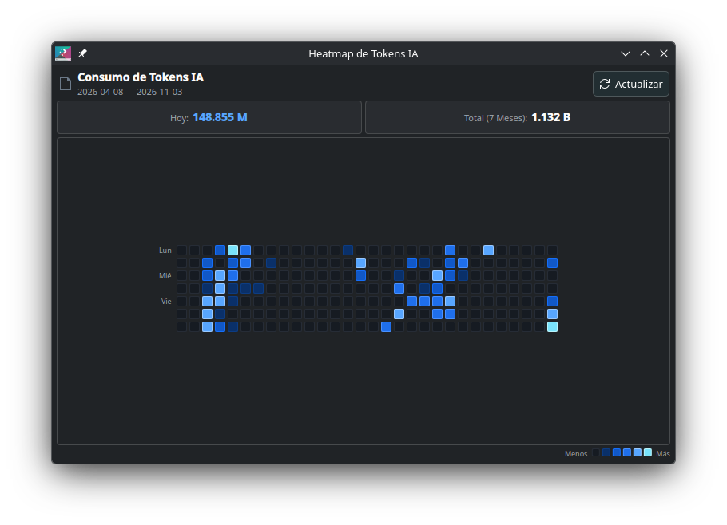

<div align="center">
  
  <br/><br/>

  [](https://kde.org/plasma-desktop/)
  [](https://python.org)
  [](LICENSE)
  []()

  <p>A native <b>KDE Plasma 6</b> desktop & panel widget that visualizes your AI token consumption as a <b>GitHub-style contribution heatmap (7 days x 30 weeks)</b>. Automatically tracks tokens across popular AI coding agents, operating <b>100% locally with zero cloud or external dependencies</b>.</p>

  <br/>
  
</div>

---

## 🌟 Supported AI Harnesses & Agents

WidgetTokens automatically discovers and parses token usage from:

| Agent / Harness | Source Path | Extraction Method |
| :--- | :--- | :--- |
| **OpenCode** (`⚡`) | `~/.local/share/opencode/opencode.db` | Native SQLite read-only query |
| **Antigravity** (`🚀`) | `~/.gemini/antigravity-cli/brain/*/logs/transcript.jsonl` | JSONL streaming & planner response usage |
| **Claude Code** (`🟣`) | `~/.claude/projects/*/*.jsonl` | Session conversation usage blocks |
| **Hermes Agent** (`🪽`) | `~/.hermes/state.db` | Native SQLite read-only session metrics |
| **OpenClaw** (`🦀`) | `~/.openclaw/sessions/` | Agent execution sessions and step logs |

---

## ✨ Features

- **7-Month Activity Heatmap:** 7 days/week x 30 weeks matrix rendered in Plasma's native blue theme.
- **Dynamic Quartile Color Scaling:**
  - **Level 0 (`#161b22`):** Inactive (0 tokens)
  - **Level 1 (`#0a3069`):** Low (1 — Q1)
  - **Level 2 (`#1158c7`):** Moderate (Q1 — Median)
  - **Level 3 (`#1f6feb`):** High (Median — Q3)
  - **Level 4 (`#58a6ff`):** Very High (Q3 — 100M)
  - **Level 5 (`#79e2fb`):** **Epic (> 100M tokens)** highlighted in neon cyan.
- **Detailed Interactive Tooltips:**
  - Hovering any day displays total tokens, active harnesses only (inactive tools are hidden), and token breakdown (`Input`, `Output`, `Cache`).
  - Hovering the color legend squares displays the exact numerical boundaries of each tier.
- **Clean & Human-Readable Numbers:** Formats millions as `52.096 M` and thousands as `245 k` (eliminates ugly scientific notation).
- **100% Local & Private (Standalone):** No tracking servers, external APIs, or network requests required. All data remains strictly on your local disk.
- **Compact & Elastic UI:** Minimum width of 420px, responsive layout with smooth flickable container, fits in desktop setups and panels alike.
- **Zero Heavy Dependencies:** Python backend is implemented exclusively using standard libraries (`sqlite3`, `json`, `hashlib`, `glob`).

---

## 🚀 Installation

### Option 1: Direct from KDE Store (Plug & Play - Recommended)
1. Right-click your desktop or panel ➔ **Add Widgets...** ➔ **Get New Widgets...** ➔ **Download New Plasma Widgets**.
2. Search for **AI Tokens Heatmap** and click **Install**.
3. Add the widget to your desktop or panel.

*Zero setup required! The widget contains an embedded autonomous Python engine that automatically detects your local agent databases, extracts token counts, and refreshes the heatmap in the background.*

### Option 2: From Source
```bash
git clone https://github.com/MarcoCS003/widgettokens.git
cd widgettokens
./install.sh
```

### Preview Immediately
You can test the widget in a standalone window without adding it to your desktop:

```bash
plasmawindowed org.kde.plasma.tokens
```

Or right-click your desktop / panel -> **Add Widgets...** -> Search for **Consumo de Tokens IA**.

---

## 📁 Repository Structure

```text
widgettokens/
├── backend/
│   ├── core/
│   │   ├── __init__.py
│   │   ├── db.py                 # SQLite storage, state watermarks & matrix aggregator
│   │   └── extractor.py          # Parsers for OpenCode, Antigravity, Claude, Hermes, OpenClaw
│   ├── collector.py              # Local extraction runner & atomic history exporter
│   ├── server.py                 # Optional REST server (for multi-machine setups)
│   ├── syncer.py                 # Optional delta syncer (for multi-machine setups)
│   └── systemd/
│       ├── widgettokens.service  # Standalone local collector oneshot service
│       └── widgettokens.timer    # 3-minute periodic user timer
├── plasmoid/
│   ├── metadata.json             # Plasma 6 applet metadata
│   └── contents/
│       └── ui/
│           ├── main.qml                  # Root PlasmoidItem & DataSource loader
│           ├── CompactRepresentation.qml # Panel icon & compact token badge
│           ├── FullRepresentation.qml    # Main expanded desktop view
│           └── HeatmapGrid.qml           # 7x30 Heatmap grid & interactive tooltips
├── tests/
│   ├── test_extractor_and_db.py  # Unit tests for database & parsers
│   ├── test_server.py            # Unit tests for HTTP endpoints
│   └── test_collector_and_syncer.py # Unit tests for sync cycles
├── install.sh                    # Automated setup script
└── LICENSE                       # MIT License
```

---

## 🧪 Running Unit Tests

The test suite runs with standard Python `unittest`:

```bash
python3 -m unittest discover tests -v
```

---

## 📄 License

This project is licensed under the [MIT License](LICENSE).
Feel free to use, modify, and distribute it.
